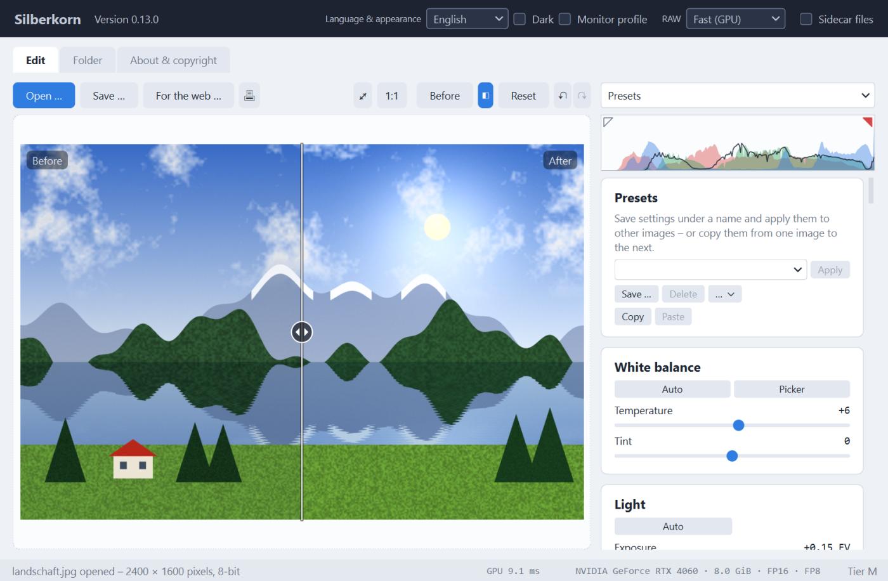

# Silberkorn

**Silberkorn - An open-source, GPU-accelerated AI image & photo enhancer powered by neural networks.**<br>
**Silberkorn - ein quelloffener, GPU-beschleunigter KI-Bild- und Fotoverbesserer auf Basis neuronaler Netze.**

[](https://github.com/DerAlexmann/Silberkorn/actions/workflows/ci.yml)

Supports hardware acceleration via NVIDIA CUDA / RTX series GPUs.

*NVIDIA and RTX are trademarks of NVIDIA Corporation.*

*[Deutsche Fassung: README.md](README.md)*

> **Version 0.x.** Basic adjustments, RAW development and the AI features are usable;
> the user interface and settings files may still change before version 1.0.



## System requirements

Silberkorn computes on the graphics card only. **Without an NVIDIA RTX graphics card
the program does not start**; instead it reports what was found and what is missing.
There is deliberately no fallback mode on the CPU.

| | Minimum |
|---|---|
| Operating system | Windows 10 or 11, 64-bit |
| Graphics card | NVIDIA GeForce RTX 2000 series or newer, including professional RTX cards (RTX A series, RTX Ada) |
| Video memory | 4 GB for AI features; below that classic filters only |
| Graphics driver | NVIDIA 570.65 or newer |
| Python (only when run as a script) | 3.10 or newer |

**Not supported** are GTX cards – including the GTX 16 series, which belongs to the same
generation as the RTX 2000 but has no Tensor Cores – and graphics cards from other
vendors.

### Feature tiers

What is available depends mainly on the video memory. Silberkorn detects the tier at
start-up; features of a higher tier are shown greyed out with a note.

| Tier | Video memory | Examples | Scope |
|---|---|---|---|
| – | below 4 GB | RTX 2050 (laptop) | classic filters only |
| S | 4 GB | RTX 3050 Laptop | classic filters, small AI models |
| M | 6–8 GB | RTX 2060, 3060 Ti, 4060, 5060 | all restoration models: upscaling, denoising, background removal, object selection |
| L | 12–16 GB | RTX 3060 12 GB, 4070, 5070 Ti | in addition larger models and generative fill |
| XL | 24 GB and more | RTX 3090, 4090, 5090 | full feature set |

Precision: all RTX cards compute in FP16; from the RTX 4000 (Ada) also in FP8, from the
RTX 5000 (Blackwell) also in FP4. The values are shown on the "About & copyright" tab.

## What it does already

- **Basic adjustments on the GPU**: white balance (temperature, tint), exposure,
  contrast, highlights, shadows, vibrance, saturation and sharpening with adjustable
  radius.
- **Tone curve** for luminance and for red, green and blue separately, with a histogram
  in the background. Click to add a point, drag to move it, double-click to remove it;
  the luminance curve leaves the colours untouched.
- **Clarity**: more or less local contrast in the midtones.
- **Dehaze** using the dark channel prior – also in reverse, to add haze.
- **Colour ranges (HSL)**: hue, saturation and luminance separately for red, orange,
  yellow, green, aqua, blue, purple and magenta. Computed in the perceptually uniform
  OkLCh colour space with soft transitions between the ranges; greys stay untouched.
- **LUTs**: load looks as `.cube` files (3D and 1D), tetrahedral interpolation, with a
  strength slider.
- **Noise reduction**: luminance noise with non-local means, colour noise with a
  colour-guided filter that keeps colour edges – even between colours of equal
  brightness. The scaled-down preview shows less noise than the saved image – use the
  100 % view to judge it.
- **AI denoise** with SCUNet, trained on real camera noise and for fidelity rather than
  invented detail: computed once over the whole image (an 18 MP photo takes about 20
  seconds on an RTX 4060, 11 with TensorRT); after that a strength slider instantly blends
  between original and denoised image – in the preview, the 100 % view and the export
  alike. Highlights above white, for example from RAWs, are preserved.
- **AI sharpen** for slight focus blur with Restormer, trained on real out-of-focus
  photos from a DSLR and for fidelity: eyelashes, hair and skin texture become clearer
  again, without the halos of classic sharpening. Computed once over the whole image
  (24 MP on an RTX 4060: about three minutes, 45 seconds with TensorRT); after that a
  strength slider responds instantly. If AI denoise has been computed, the denoised image
  is sharpened; only the fine part of the correction is applied, brightness and colour
  stay unchanged.
- **Subject & background** with BiRefNet: the AI detects the subject – people, animals,
  objects – including hair in about two seconds. After that, exposure, contrast,
  saturation, temperature and blur of the background can be set separately, for example
  to darken or soften it; "Invert" applies the sliders to the subject. The edge can be
  softened and shifted, and a mask view tints the background for checking. When saving
  as PNG or TIFF, the background can be made transparent. Needs at least 6 GB of graphics
  memory.
- **Select an object by clicking** with Segment Anything 2 (SAM 2.1), in the same card:
  left-click in the image adds an object or an area, right-click removes one, Ctrl+Z
  undoes the last click. Every click shows the selection within a fraction of a second;
  the sliders, "Invert" and transparent saving work on it like on the detected subject.
  Works from 4 GB of graphics memory.
- **Remove objects** with LaMa: click an object (SAM 2) or paint over it with the brush,
  for example spots or wires – "Remove" fills the spot within a fraction of a second with
  what could be behind it. Several removals build on each other, the last one can be
  undone; the sliders keep working on the whole image. From 4 GB of graphics memory.
- **Depth & bokeh** with Depth Anything V2: the AI estimates in a fraction of a second how
  far away everything in the image is. After that, "Blur" softens the image like a fast
  lens – the more, the further something lies in front of or behind the focal plane. The
  focus is set by a click in the image or a slider, "Depth of field" decides how much
  stays sharp, and a detected subject can be kept fully sharp. The blur is computed in
  linear light so that highlights bloom, and sharp areas do not bleed into blurred ones.
  From 4 GB of graphics memory.
- **AI colourise** with DDColor: black-and-white and sepia images get colour. The AI only
  sees the brightness and estimates the colours from it – plausible, but guessed, not
  historically reliable. The brightness stays that of the original pixel for pixel, even
  for large scans; a slider blends the colour in smoothly, and white balance, saturation
  and colour ranges work as usual afterwards. About 0.1 s, from 4 GB of graphics memory.
- **AI extend** with FLUX.2 [klein] 4B and the outpaint LoRA by fal: instead of cropping
  to an aspect ratio, the AI invents the missing borders to match the image – for
  example to turn a 4:3 photo into 16:9. The original is kept pixel for pixel and set in
  with a soft seam; a colour cast of the AI is measured on the original and removed.
  "Regenerate" rolls new borders; the sliders then work on the whole image. If more than
  a quarter per side is added, the program points out that the AI then invents more
  than it sees. About 15 seconds on an RTX 4060; needs 8 GB of graphics memory.
- **Anonymise**: pixelate, blur or fill faces, number plates or house numbers in black –
  as a rectangle or an ellipse. "Find faces" places an area around every detected face
  (YuNet, included with the program, runs on the processor); areas can be moved,
  resized, removed and drawn by hand. They follow rotation and crop. The mosaic is
  coarse by default, as fine mosaics can be partly reversed. On request Silberkorn saves
  without the GPS position, camera and lens serial numbers, owner name and maker notes.
  The opposite, "unpixelating", is deliberately not offered: an AI could not bring back
  a pixelated face, only invent someone else's.
- **Metadata**: the card shows camera, lens and exposure and lets you change title,
  description, keywords, creator, copyright, location, date taken and rating – for old
  prints the year alone is enough as a date. EXIF, IPTC and XMP are read, from RAW too;
  "All metadata …" shows everything the file contains. Changes are only written when
  saving, as XMP following IPTC and where possible as EXIF as well; "Reset" undoes them.
  On request Silberkorn adds the creator and copyright to every image that has none of
  its own. Technical values such as exposure time or ISO stay unchanged. The orientation
  and the develop settings of other programs (Lightroom, darktable) are dropped from the
  XMP so that they do not take effect a second time there.
- **Save for publishing**: images for the web in one step – downsized to a longest edge
  (quick picks 1280, 1920, 2560 pixels) or a percentage, never enlarged. Plus a visible
  watermark from text and/or a logo, in a corner, in the centre or as a pattern across
  the whole image, with size and opacity. Creator, copyright and web address go into the
  file (EXIF and XMP following IPTC), and on request a machine-readable reservation
  against AI training and data mining (IPTC "Data Mining"; search engines stay allowed).
  GPS position and serial numbers are always removed, the other camera data on request.
  If the image contains parts invented by AI, this is noted (IPTC "Digital Source
  Type"). A preview shows the result; the settings are kept as a template. The original
  stays unchanged. Copying published images cannot be prevented entirely – but the
  watermark and rights information make it unattractive and show where an image came
  from.
- **Print** (🖶 or `Ctrl`+`P`): choose printer and paper, fit the image to the whole page
  or to 9 × 13, 10 × 15, 13 × 18, 20 × 30 cm or a custom size – shown in full or filling
  the area and cropped, with a margin or borderless. A preview shows the sheet, along
  with the resolution on paper. If it is low, the dialog offers to enlarge the image with
  AI first. The edited image is printed at full resolution as sRGB; colour matching is
  left to the printer driver. By default the dialog picks 10 × 15 cm paper if the printer
  knows it.
- **Geometry**: rotate by 90°, flip, straighten, vertical and horizontal perspective, crop
  with a frame and fixed aspect ratios. Empty corners after straightening are cropped
  away automatically.
- **Lens**: correct distortion, vignetting and colour fringes (chromatic aberration) – by
  hand or automatically with **lens profiles** from the [lensfun](https://lensfun.github.io)
  database (CC BY-SA 3.0). Camera, lens, focal length and aperture are read from the
  file, adapted lenses included. For RAW a matching profile is applied right away, for
  JPEG only on request (the camera has often corrected it already). Silberkorn downloads
  the database (about 0.5 MB) at the push of a button and checks for a newer one the same
  way – never on its own. All geometry and lens corrections are resampled in a single
  bicubic step.
- **AI upscaling** by 2 × or 4 × when saving, with Real-ESRGAN via ONNX Runtime on the
  GPU: a fast model with a denoise strength slider (from 4 GB of video memory) and a
  large model with more sharpness (from feature tier M). Processing runs in half
  precision (FP16) on the tensor cores and in tiles sized to the video memory; with the
  fast model an RTX 4060 upscales a 24 MP image to 96 MP in just under 6 seconds. The
  optional [TensorRT](#tensorrt-optional) makes it about twice as fast again.
- **100 % view**: zoom to 100, 200 and 400 % with the mouse wheel, pan by dragging,
  double-click toggles between fit and 100 %. It shows a part of the image at full
  resolution – exactly what will be saved. The zoom level is shown at the top right of
  the image.
- **Non-destructive**: every change is recomputed from the untouched original.
  Double-click resets a slider, "Before" shows the original while the button is held.
- **Card picker**: a drop-down above the cards jumps straight to any card and shows,
  while scrolling, which one is at the top.
- **Undo and redo** with ↶ ↷ or `Ctrl`+`Z` / `Ctrl`+`Y`: for sliders, curves, crop,
  metadata and also AI steps such as denoising, a removed object or an extension – and
  for "Reset". One drag of a slider is one step; the tooltip says what will be undone.
  Superseded AI results take up at most a fifth of the video memory on top; older steps
  are dropped for that.
- **Sidecar file**: when switching images and on exit, Silberkorn saves the edit in a
  small file next to the image (`photo.jpg.silberkorn`) – sliders, curves, LUT, removed
  objects, dust, mask, depth and AI expansion. The next time the image is opened,
  everything is as before. AI denoise, sharpen and colourise are not stored – they would
  take hundreds of MB – and are recomputed on request. The first time, Silberkorn asks
  whether it may create sidecar files; "Sidecar files" at the top changes that. If a
  sidecar file no longer matches the image because the image was changed, Silberkorn
  applies only the slider values after asking. Once everything is reset, it disappears.
- **Folder view** ("Folder" tab): the images of a folder as tiles; a double-click opens
  one for editing. A dot marks images with a sidecar file; their tile shows the edited
  image. Previews are made in the background and only for what is visible – from the
  embedded preview of a RAW, from a JPEG decoded at an eighth of its size or, for large
  TIFFs and PNGs, from the **preview cache**: a file of fixed size you choose (200 MB
  suggested, 0 = off) that is reserved right away. Every preview and path in it is
  encrypted for your own Windows sign-in with the Data Protection API; deleted entries
  are overwritten, and folders can be excluded entirely.
- **Batch**: select several images in the folder view (`Ctrl`/`Shift`) and process them
  in one go with "Batch …" – apply a preset or copied settings, remove dust via the
  infrared channel, save the edit as a sidecar file and/or export the images: into a
  folder, as JPEG, PNG, TIFF or WebP, with a name suffix, optionally with AI denoise,
  sharpen, colourise and AI upscaling. Existing files are never overwritten. One image
  at a time, cancellable; an error only affects its own image, and a report follows at
  the end.
- **Presets**: save settings under a name and apply them to other images – choosing
  what to include: basic adjustments, curves, colour ranges, LUT, noise reduction and
  film are preselected; geometry, anonymisation and metadata usually belong to one image
  only. For film, optionally with the measured film base for images from the same strip;
  otherwise it is estimated anew for each image. `Ctrl`+`Shift`+`C` / `V` copy settings
  straight from one image to the next. Presets are stored as JSON in the `voreinstellungen`
  folder next to the program and can be imported and exported.
- **Fast**: the preview is computed at screen resolution in a few milliseconds; the
  computing time is shown in the status bar. Saving uses the full resolution.
- **Colour-accurate**: processing happens in linear light with 32-bit floating point.
  RGB colour profiles such as Adobe RGB, ProPhoto RGB or Display P3 are converted to sRGB
  on the GPU without a detour through 8 bits; colours outside sRGB are kept until the
  output. The EXIF orientation is applied; metadata (EXIF, IPTC, XMP) and an alpha
  channel are kept when saving in every format – the camera data of a RAW included.
- **16 bits and RAW**: opens and saves TIFF and PNG with 16 bits per channel. RAW files
  from practically every camera (CR2, CR3, NEF, ARW, RAF, ORF, RW2, DNG and more) are
  developed in linear light without automatic brightening – the full range of the sensor
  is kept, and exposure controls the brightness. For Bayer sensors, i.e. almost every
  camera, demosaicing runs on the GPU – after Malvar, He and Cutler. A 24-megapixel RAW
  opens in about 0.2 s instead of over a second. Fujifilm X-Trans sensors are developed
  on the GPU as well, with a dedicated edge-aware method for the 6×6 pattern – hardly
  distinguishable from LibRaw, but in milliseconds instead of seconds. For even fewer
  colour fringes in fine patterns, choose "RAW: Best quality" at the top – then LibRaw
  develops on the processor, with DHT or, for X-Trans, Markesteijn (about 1.5 to 3 s).
  Other sensors (Foveon …) are always developed by LibRaw.
- **Scan & film**: scanned negatives or negatives photographed with a camera – colour or
  black-and-white – are converted into positives via the density of the film, as in the
  lab. Silberkorn estimates the orange film base as well as black and white point per
  colour channel by itself and so removes the colour cast; the unexposed film border can
  also be picked with the eyedropper. After that, all sliders and AI cards work on the
  positive. TIFF scans with an infrared channel (RGBI, for example from VueScan or
  SilverFast) are recognised as such instead of showing up half transparent. Through
  this channel the card finds dust, fibres and scratches – film lets infrared through,
  dust does not – and fills them: small specks on the GPU, wide spots with LaMa. At
  24 megapixels this takes less than a second; "Before" and undo work as usual. An
  infrared channel that shows the scene itself (aerial images, black-and-white film with
  silver, Kodachrome) is recognised and not taken for dust.
  "Split photos …" finds several prints on a flatbed scan, crooked ones included,
  straightens each one, crops it to its edge and saves it as a file of its own (Name-01,
  Name-02 …, without overwriting anything); Silberkorn then opens one of them for editing.
- **Formats**: opens JPEG, PNG, TIFF, WebP, BMP and RAW (HEIC with the optional
  `pillow-heif` package); saves JPEG and WebP with 8 bits, PNG and TIFF with 8 or 16 bits.
  For images with more than 8 bits the save dialog suggests a 16-bit TIFF.

| Card picker | Scan & film |
|---|---|
|  |  |
| **Split photos** | |
|  | |

*The motifs are computed, not photographs – made with `werkzeuge/bildschirmfotos.py`.*

| Key | Action |
|---|---|
| `Ctrl`+`O` | open an image (or drag a file onto the canvas) |
| `Ctrl`+`S` | save … – always under a new name, the original is never overwritten silently |
| `Ctrl`+`P` | print … |
| `Ctrl`+`Z` / `Ctrl`+`Y` | undo / redo (also `Ctrl`+`Shift`+`Z`); while selecting by click, `Ctrl`+`Z` first undoes the clicks |
| `Ctrl`+`Shift`+`C` / `V` | copy settings / paste them onto another image |
| `Ctrl`+`0` / `Ctrl`+`1` | fit / 100 % |
| mouse wheel, drag, double-click | zoom, pan, toggle between fit and 100 % |
| `Enter` / `Esc` | apply / cancel crop |

## Running it

**As a script:**

```bash
pip install -r requirements.txt
python Silberkorn.pyw
```

The packages bring CuPy and the required CUDA libraries from NVIDIA (just over 1 GB in
total); a separate CUDA Toolkit installation is not needed.

**As a program (Windows):** unpack the ZIP from the release and start
`Silberkorn.exe` – no installation, no admin rights.

The executable does not include CUDA and cuDNN: NVIDIA's licences do not allow them to
be passed on together with Silberkorn. At first start the program therefore asks,
names source, size and NVIDIA's licence terms and, once you agree, downloads NVIDIA's
official packages from the Python Package Index once – 1.6 GB, about 2.3 GB unpacked in
the `nvidia` folder next to the executable. Every file is verified against its
checksum. The executable computes with CUDA; TensorRT is only available in the Python
version.

**The program seems to hang briefly the first time you edit** – this is expected and
not a crash. When you move a slider for the first time, the graphics card compiles the
filter programs for exactly this card; this takes a few seconds. After that all sliders
respond smoothly. The compiled programs are saved (`%USERPROFILE%\.cupy\kernel_cache`),
so later starts are much faster.

**Building the executable yourself:** `build.cmd` creates the clean environment
`.venv-build` (only the packages from `requirements-build.txt`) and uses PyInstaller to
produce the folder `dist\Silberkorn` and the ZIP with its SHA-256. The licence texts of
all bundled packages are placed next to the executable (`lizenzen/`,
`DRITTANBIETER.txt`).

### TensorRT (optional)

With TensorRT the AI runs about twice as fast again – on an RTX 4060 the large model
upscales a 12 MP image in 24 instead of 54 seconds:

```bash
pip install -r requirements-tensorrt.txt
```

That is about 1.8 GB to download (2.8 GB installed) from NVIDIA's package index.
Silberkorn detects TensorRT by itself; "Info & Copyright" shows the version. The
first time a model is used, TensorRT builds an engine for the graphics card once – this
takes one to three minutes (up to ten for AI sharpen and subject detection), and a
window says so. The engines are then kept in the
`modelle/tensorrt` folder. If TensorRT does not work, the program computes with CUDA as
it does without it.

TensorRT is licensed under a proprietary NVIDIA licence that applies on installation.
It does not allow TensorRT to be passed on together with Silberkorn – which is why
it is not part of any ready-made executable and is always installed separately.

## Privacy

Silberkorn works entirely on your own computer. No images are uploaded and no usage
data is sent. The AI also runs locally on the graphics card, face detection on the processor. The only network access is
downloading an AI model – and only when you explicitly ask for it in the "AI upscaling",
"AI denoise", "AI sharpen", "AI colourise", "Subject & background", "Remove objects" or
"Depth & bokeh"
card or at "Extend with AI" in the "Geometry" card and confirm the prompt that names source, size and
licence. The executable also downloads the NVIDIA libraries from pypi.org at first
start – likewise only after you agree. The lensfun lens database is only downloaded at
the push of a button in the "Lens" card, and the same goes for checking for a newer one.

Besides the slider values, a sidecar file contains a small preview of the edit and any
metadata entered, such as title or creator – passing on an image together with its
sidecar file passes on both. Sidecar files and presets from others are read with strict
checks: only known values within their limits, no file paths, nothing executable.

The folder view's preview cache lives in `%LOCALAPPDATA%\Silberkorn\vorschau.db` (the
location can be changed). Previews and paths in it are encrypted with the Windows Data
Protection API (DPAPI); lookups use a secret hash of the path. A copied file, a backup
or a removed drive therefore reveals neither images nor folder names. Images that no
longer exist drop out; after anonymising, no preview of the original remains. This does
not protect against malware running under your own account – but such malware could
read the photos themselves anyway. For the whole drive, BitLocker remains the right
layer.

## AI models

The models are not part of the program. "Download model" fetches them from releases of
this project: in the "AI upscaling" card from
[modelle-1](https://github.com/DerAlexmann/Silberkorn/releases/tag/modelle-1) the fast
model with just under 10 MB and the large one with 64 MB, in the "AI denoise" card from
[modelle-2](https://github.com/DerAlexmann/Silberkorn/releases/tag/modelle-2) SCUNet
with 71 MB, in the "AI sharpen" card from
[modelle-3](https://github.com/DerAlexmann/Silberkorn/releases/tag/modelle-3) Restormer
with 101 MB, in the "Subject & background" card from
[modelle-4](https://github.com/DerAlexmann/Silberkorn/releases/tag/modelle-4) BiRefNet
with 177 MB and for "Click object" from
[modelle-5](https://github.com/DerAlexmann/Silberkorn/releases/tag/modelle-5) SAM 2
with 147 MB, in the "Remove objects" card from
[modelle-6](https://github.com/DerAlexmann/Silberkorn/releases/tag/modelle-6) LaMa
with 196 MB, in the "Depth & bokeh" card from
[modelle-7](https://github.com/DerAlexmann/Silberkorn/releases/tag/modelle-7) Depth
Anything V2 Small with 98 MB, and for "Extend with AI" in the "Geometry" card from
[modelle-8](https://github.com/DerAlexmann/Silberkorn/releases/tag/modelle-8) FLUX.2
[klein] 4B with the outpaint LoRA with about 4.1 GB – split into several files, as GitHub
accepts at most 2 GB per file –, and in the "AI colourise" card from
[modelle-9](https://github.com/DerAlexmann/Silberkorn/releases/tag/modelle-9) DDColor
(small version) with 210 MB. Every file is checked against its SHA-256 checksum before it is used. They are stored in the `modelle`
folder next to the program or, if that is read-only, in
`%LOCALAPPDATA%\Silberkorn\modelle`.

The models are the official weights of [Real-ESRGAN](https://github.com/xinntao/Real-ESRGAN)
(BSD 3-Clause, Copyright 2021 Xintao Wang), [SCUNet](https://github.com/cszn/SCUNet)
(Apache-2.0, Copyright 2022 Kai Zhang), [Restormer](https://github.com/swz30/Restormer)
(MIT, Copyright 2022 Syed Waqas Zamir), [BiRefNet](https://github.com/ZhengPeng7/BiRefNet)
(MIT, Copyright 2024 ZhengPeng) and [SAM 2](https://github.com/facebookresearch/sam2)
(Apache-2.0, Copyright Meta Platforms, Inc. and affiliates) and
[LaMa](https://github.com/advimman/lama) (Apache-2.0, Copyright 2021 Samsung Research)
and [Depth Anything V2](https://github.com/DepthAnything/Depth-Anything-V2) Small
(Apache-2.0) and [DDColor](https://github.com/piddnad/DDColor) in its small version
(Apache-2.0, Xiaoyang Kang et al.), converted to ONNX; in addition
[FLUX.2 [klein] 4B](https://huggingface.co/black-forest-labs/FLUX.2-klein-4B)
(Apache-2.0, Black Forest Labs) with the
[outpaint LoRA by fal](https://huggingface.co/fal/flux-2-klein-4B-outpaint-lora)
(Apache-2.0), with the LoRA merged in and the transformer quantised to int8 (NOTICE lists
all changes). To reproduce this yourself:

1. Download `realesr-general-x4v3.pth`, `realesr-general-wdn-x4v3.pth` and
   `RealESRGAN_x4plus.pth` from the
   [Real-ESRGAN releases](https://github.com/xinntao/Real-ESRGAN/releases), and
   `scunet_color_real_psnr.pth` from the
   [KAIR release v1.0](https://github.com/cszn/KAIR/releases/tag/v1.0), where the SCUNet
   weights are published, and `single_image_defocus_deblurring.pth` from the
   [Restormer release v1.0](https://github.com/swz30/Restormer/releases/tag/v1.0) and
   `BiRefNet_lite-general-2K-epoch_232.pth` from the
   [BiRefNet release v1](https://github.com/ZhengPeng7/BiRefNet/releases/tag/v1) and
   [`sam2.1_hiera_small.pt`](https://dl.fbaipublicfiles.com/segment_anything_2/092824/sam2.1_hiera_small.pt)
   from Meta and `big-lama.zip` of LaMa (the download named in the
   [LaMa instructions](https://github.com/advimman/lama), hosted on
   [Hugging Face](https://huggingface.co/smartywu/big-lama)) and
   `depth_anything_v2_vits.pth` from
   [Depth-Anything-V2-Small](https://huggingface.co/depth-anything/Depth-Anything-V2-Small)
   and `pytorch_model.bin` from
   [ddcolor_paper_tiny](https://huggingface.co/piddnad/ddcolor_paper_tiny), renamed to
   `ddcolor_paper_tiny.bin`,
   into `modelle/quellen/`, and unpack `big-lama.zip` there.
2. `pip install torch` (only needed for this step).
3. `python werkzeuge/modelle_exportieren.py` – this writes the ONNX models to `modelle/`
   and checks them against PyTorch.
4. For AI extend, download from Hugging Face
   [FLUX.2-klein-base-4B](https://huggingface.co/black-forest-labs/FLUX.2-klein-base-4B)
   (text encoder, tokenizer, VAE, scheduler) into `<folder>/klein-base-4b/`, the
   transformer of [FLUX.2-klein-4B](https://huggingface.co/black-forest-labs/FLUX.2-klein-4B)
   into `<folder>/klein-4b-destilliert/transformer/` and `flux-outpaint-lora.safetensors`
   from [fal](https://huggingface.co/fal/flux-2-klein-4B-outpaint-lora) into
   `<folder>/lora/`, then run
   `pip install torch diffusers peft transformers onnx onnx-ir scipy` and
   `python werkzeuge/outpaint_export.py <folder>`. This needs about 30 GB of RAM and
   checks every network as well as the whole pipeline against diffusers.

## A note on AI results

AI methods such as upscaling or denoising add image details that were not present in the
original. Processed images are therefore not suitable as evidence or for documentation
purposes.

## Contributing

Bug reports, suggestions and translations are welcome – [CONTRIBUTING.md](CONTRIBUTING.md)
explains structure, style and tests (in German; issues and pull requests in English are
just as welcome). Please report security issues not as an issue but as described in
[SECURITY.md](SECURITY.md).

## Licence and legal notices

[MIT](LICENSE) – Copyright 2026 Alexander Unverhau.
Created with assistance of Claude AI.

The exception are the re-implementations of third-party networks in
`werkzeuge/netz_*.py`, which only serve to convert the AI models and are not part of the
program: each is under the licence of its original (Apache-2.0, MIT or BSD-3-Clause), as
stated in the file header; the licence texts are in [LICENSES](LICENSES).

Third-party components and their licences are listed in [NOTICE](NOTICE). AI models are
subject to their own licences, which are shown before downloading. The NVIDIA libraries
(CUDA, cuDNN, optionally TensorRT) are installed by pip from NVIDIA's own packages; they
are under NVIDIA's licences, not under the MIT licence.

**Trademarks:** NVIDIA, RTX, GeForce, CUDA and TensorRT are trademarks or registered
trademarks of NVIDIA Corporation in the U.S. and other countries. Qt is a trademark of The
Qt Company Ltd., Python a trademark of the Python Software Foundation, Windows a trademark
of Microsoft Corporation. All other trademarks are the property of their respective
owners.

Silberkorn is an independent project and is not affiliated with, endorsed or sponsored
by NVIDIA Corporation.
