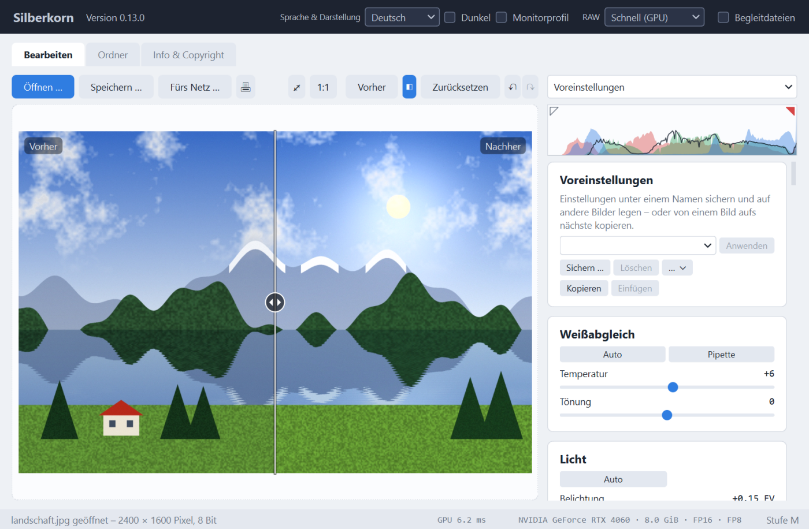
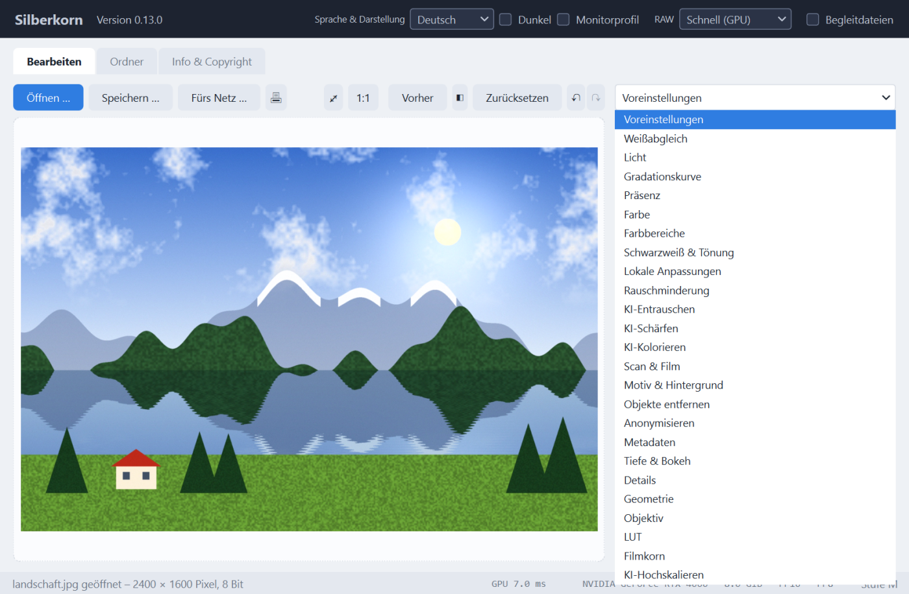
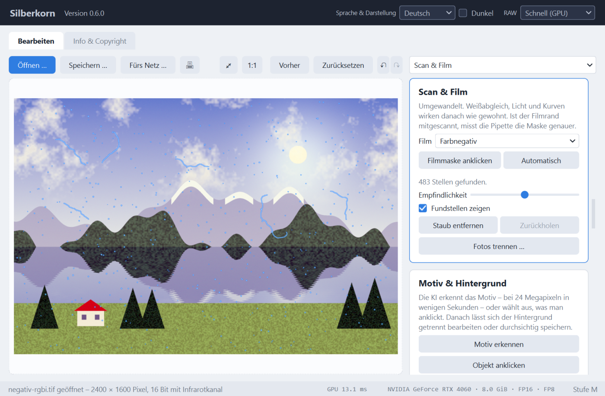
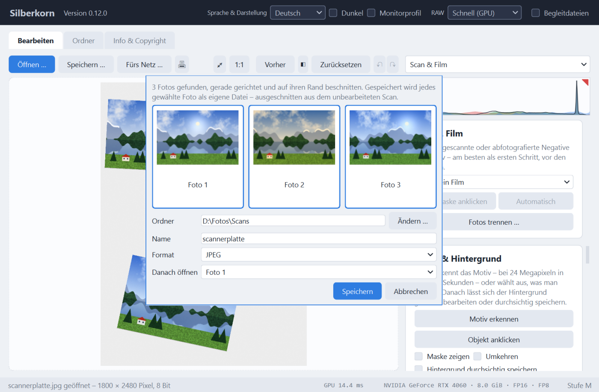
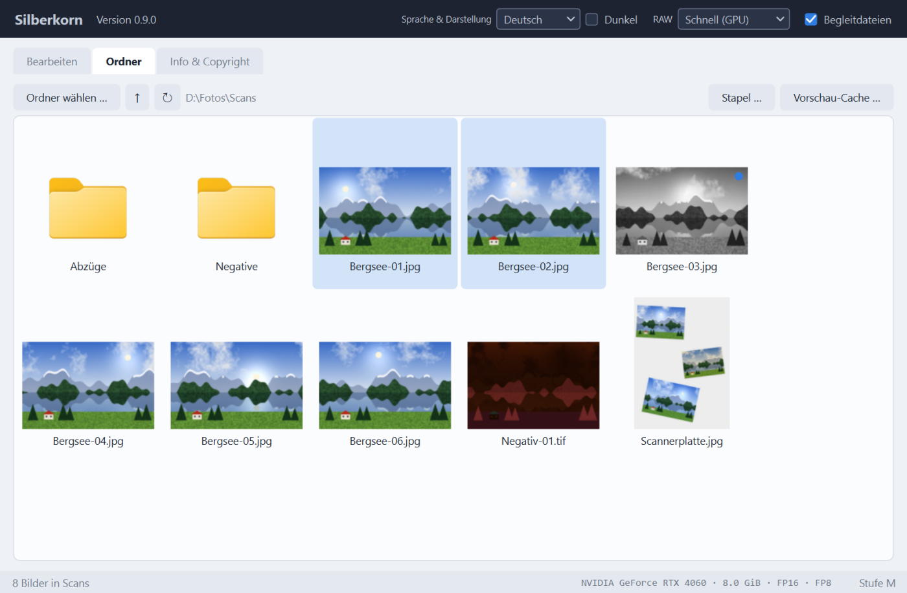

# Silberkorn

**Silberkorn - An open-source, GPU-accelerated AI image & photo enhancer powered by neural networks.**<br>
**Silberkorn - ein quelloffener, GPU-beschleunigter KI-Bild- und Fotoverbesserer auf Basis neuronaler Netze.**

[](https://github.com/DerAlexmann/Silberkorn/actions/workflows/ci.yml)

Supports hardware acceleration via NVIDIA CUDA / RTX series GPUs.<br>
Unterstützt Hardwarebeschleunigung über NVIDIA CUDA und Grafikkarten der RTX-Serie.

*NVIDIA and RTX are trademarks of NVIDIA Corporation. – NVIDIA und RTX sind Marken der
NVIDIA Corporation.*

*[English version: README.en.md](README.en.md)*

> **Version 0.x.** Grundregler, RAW-Entwicklung und die KI-Funktionen sind nutzbar;
> Bedienung und Einstellungsdateien können sich bis Version 1.0 noch ändern.



## Systemvoraussetzungen

Silberkorn rechnet ausschließlich auf der Grafikkarte. **Ohne NVIDIA-RTX-Grafikkarte
startet das Programm nicht**, sondern meldet beim Start, was gefunden wurde und was fehlt.
Einen Notbetrieb auf dem Prozessor gibt es bewusst nicht.

| | Mindestens |
|---|---|
| Betriebssystem | Windows 10 oder 11, 64 Bit |
| Grafikkarte | NVIDIA GeForce RTX 2000-Serie oder neuer, auch RTX-Profikarten (RTX A-Serie, RTX Ada) |
| Grafikspeicher | 4 GB für KI-Funktionen; darunter nur klassische Filter |
| Grafiktreiber | NVIDIA 570.65 oder neuer |
| Python (nur für den Start als Skript) | 3.10 oder neuer |

**Nicht unterstützt** werden GTX-Karten – auch die GTX-16-Serie, die zwar zur selben
Generation wie die RTX 2000 gehört, aber keine Tensor Cores hat – sowie Grafikkarten
anderer Hersteller.

### Funktionsstufen

Was verfügbar ist, hängt vor allem vom Grafikspeicher ab. Silberkorn erkennt die
Stufe beim Start; Funktionen einer höheren Stufe erscheinen ausgegraut mit Hinweis.

| Stufe | Grafikspeicher | Beispiele | Umfang |
|---|---|---|---|
| – | unter 4 GB | RTX 2050 (Laptop) | nur klassische Filter |
| S | 4 GB | RTX 3050 Laptop | klassische Filter, kleine KI-Modelle |
| M | 6–8 GB | RTX 2060, 3060 Ti, 4060, 5060 | alle Restaurierungsmodelle: Hochskalieren, Entrauschen, Freistellen, Objektauswahl |
| L | 12–16 GB | RTX 3060 12 GB, 4070, 5070 Ti | zusätzlich größere Modelle und generative Füllung |
| XL | 24 GB und mehr | RTX 3090, 4090, 5090 | voller Umfang |

Rechengenauigkeit: alle RTX-Karten rechnen in FP16; ab RTX 4000 (Ada) zusätzlich FP8, ab
RTX 5000 (Blackwell) auch FP4. Die Werte stehen auf dem Reiter „Info & Copyright".

## Was es schon kann

- **Grundregler auf der GPU**: Weißabgleich (Temperatur, Tönung), Belichtung,
  Kontrast, Lichter, Tiefen, Dynamik, Sättigung und Schärfen mit einstellbarem
  Radius.
- **Gradationskurve** für die Helligkeit und für Rot, Grün und Blau einzeln, mit
  Histogramm im Hintergrund. Klicken setzt einen Punkt, Ziehen verschiebt ihn,
  Doppelklick entfernt ihn; die Helligkeitskurve verändert die Farben nicht.
- **Klarheit**: mehr oder weniger lokaler Kontrast in den Mitteltönen.
- **Dunst entfernen** nach dem Dark-Channel-Prior-Verfahren – auch umgekehrt, um
  Dunst hinzuzufügen.
- **Farbbereiche (HSL)**: Farbton, Sättigung und Luminanz getrennt für Rot,
  Orange, Gelb, Grün, Aqua, Blau, Lila und Magenta. Gerechnet wird im
  wahrnehmungsgleichmäßigen Farbraum OkLCh, mit weichen Übergängen zwischen den
  Bereichen; Grautöne bleiben unberührt.
- **Schwarzweiß & Tönung**: Umwandeln in Schwarzweiß mit einem Mischer für
  dieselben acht Farbbereiche – wie hell wird jede Farbe als Grau? Vorlagen
  wirken wie klassische Farbfilter vor dem Objektiv (Rot, Orange, Gelb, Grün,
  Blau). Dazu eine **Teiltonung**: Lichter und Schatten getrennt einfärben, mit
  Balance – auf Schwarzweiß wie im Labor getönt (Vorlagen Sepia, Selen,
  Cyanotypie), auf Farbbildern als Farblook. Die Helligkeit bleibt dabei, Weiß
  und Schwarz bleiben neutral.
- **Lokale Anpassungen**: Regler nur für einen Bereich – bis zu zehn Masken,
  jede aus Teilen, die sich hinzufügen, abziehen, schneiden und umkehren
  lassen: Verlauf, Radial und Pinsel; dazu mit KI das **Motiv** (BiRefNet),
  ein **Objekt per Klick** (SAM 2) und ein **Tiefenbereich** (Depth Anything),
  ohne KI ein **Helligkeits-** und ein **Farbbereich** (mit Pipette). Motiv und
  Objekte stehen in der Begleitdatei; in Voreinstellungen und im Stapel
  rechnet jedes Bild Motiv und Tiefe selbst. Der Pinsel malt mit Größe, weichem
  Rand und Deckkraft, radiert mit der rechten Maustaste oder `Alt`; `[` und
  `]` ändern die Größe. Je Maske Temperatur, Tönung, Belichtung,
  Kontrast, Lichter, Tiefen, Klarheit, Dunst, Sättigung und Schärfe (negativ
  zeichnet weich). Linien und Griffe liegen direkt im Bild; die Masken folgen
  Drehen, Begradigen und Zuschnitt, „Maske zeigen“ (`O`) färbt den Bereich
  ein.
- **LUTs**: Looks als `.cube`-Datei (3D und 1D) laden, tetraedrisch
  interpoliert, mit Stärkeregler.
- **Rauschminderung**: Luminanzrauschen mit Non-Local Means, Farbrauschen mit
  einem farbgeführten Filter, der Farbkanten erhält – auch zwischen Farben
  gleicher Helligkeit. Die verkleinerte Vorschau zeigt Rauschen schwächer als
  das gespeicherte Bild – zum Beurteilen gibt es die 100-%-Ansicht.
- **Filmkorn**: einfarbiges Korn mit Stärke, Größe und Rauheit, in den
  Mitteltönen am stärksten, Schwarz und Weiß bleiben rein. Die Rauheit lässt es
  klumpen wie bei echtem Film. Die Größe gilt
  relativ zum Bild – die 100-%-Ansicht zeigt genau das Korn des gespeicherten
  Bildes, und beim KI-Hochskalieren kommt das Korn erst danach dazu, statt von
  der KI geglättet zu werden.
- **KI-Entrauschen** mit SCUNet, trainiert auf echtes Kamerarauschen und auf
  Treue statt auf erfundene Details: einmal über das ganze Bild gerechnet (ein
  18-MP-Foto braucht auf einer RTX 4060 rund 20 Sekunden, mit TensorRT 11),
  danach mischt ein Stärkeregler sofort zwischen Original und entrauschtem
  Bild – in Vorschau, 100-%-Ansicht und Export gleichermaßen. Lichter über
  Weiß, etwa aus RAWs, bleiben erhalten.
- **KI-Schärfen** gegen leichte Fokus-Unschärfe mit Restormer, trainiert auf
  echte, unscharf fotografierte Bilder einer Spiegelreflexkamera und auf Treue:
  Wimpern, Haare und Hautstruktur werden wieder klarer, ohne die Säume des
  klassischen Schärfens. Einmal über das ganze Bild gerechnet (24 MP auf einer
  RTX 4060: rund drei Minuten, mit TensorRT 45 Sekunden), danach regelt ein
  Stärkeregler ohne Wartezeit. Geschärft wird das entrauschte Bild, falls
  KI-Entrauschen berechnet ist; übernommen wird nur der feine Anteil, Helligkeit
  und Farbe bleiben unverändert.
- **Motiv & Hintergrund** mit BiRefNet: Die KI erkennt das Motiv – Personen,
  Tiere, Gegenstände – samt Haaren in rund zwei Sekunden. Danach lassen sich
  Belichtung, Kontrast, Sättigung, Temperatur und Unschärfe des Hintergrunds
  getrennt einstellen, etwa um ihn abzudunkeln oder weichzuzeichnen; „Umkehren“
  wendet die Regler aufs Motiv an. Die Kante lässt sich weicher machen und
  verschieben, eine Maskenansicht färbt den Hintergrund zur Kontrolle ein. Beim
  Speichern als PNG oder TIFF wird der Hintergrund auf Wunsch durchsichtig.
  Braucht mindestens 6 GB Grafikspeicher.
- **Objekt per Klick auswählen** mit Segment Anything 2 (SAM 2.1), in derselben
  Karte: Linksklick ins Bild nimmt ein Objekt oder einen Bereich dazu,
  Rechtsklick nimmt einen weg, Strg+Z den letzten Klick zurück. Jeder Klick
  zeigt die Auswahl nach Bruchteilen einer Sekunde; die Regler, „Umkehren“ und
  das Freistellen wirken darauf wie auf das erkannte Motiv. Geht schon ab 4 GB
  Grafikspeicher.
- **Objekte entfernen** mit LaMa: Ein Objekt anklicken (SAM 2) oder mit dem
  Pinsel übermalen, etwa Flecken oder Leitungen – „Entfernen“ füllt die Stelle
  in Bruchteilen einer Sekunde mit dem, was dahinter liegen könnte. Mehrere
  Entfernungen bauen aufeinander auf, die letzte lässt sich zurücknehmen; die
  Regler wirken weiter auf das ganze Bild. Ab 4 GB Grafikspeicher.
- **Tiefe & Bokeh** mit Depth Anything V2: Die KI schätzt in Sekundenbruchteilen,
  wie weit alles im Bild entfernt ist. Danach zeichnet „Unschärfe“ das Bild wie
  ein lichtstarkes Objektiv weich – umso stärker, je weiter etwas vor oder hinter
  der Fokusebene liegt. Den Fokus setzt ein Klick ins Bild oder ein Regler,
  „Schärfentiefe“ bestimmt, wie viel scharf bleibt; ein erkanntes Motiv bleibt
  auf Wunsch ganz scharf. Gerechnet wird in linearem Licht, damit Lichter
  aufblühen, und Scharfes läuft nicht als Schein ins Unscharfe. Ab 4 GB
  Grafikspeicher.
- **KI-Kolorieren** mit DDColor: Schwarzweiß- und Sepiabilder bekommen Farbe.
  Die KI sieht nur die Helligkeit und schätzt daraus die Farben – glaubwürdig,
  aber geraten, nicht historisch belegt. Die Helligkeit bleibt Pixel für Pixel
  die des Originals, auch bei großen Scans; ein Regler mischt die Farbe
  stufenlos ein, Weißabgleich, Sättigung und Farbbereiche wirken danach wie
  gewohnt. Rund 0,1 s, ab 4 GB Grafikspeicher.
- **KI-Erweitern** mit FLUX.2 [klein] 4B und der Outpaint-LoRA von fal: Statt
  auf ein Seitenverhältnis zuzuschneiden, erfindet die KI die fehlenden Ränder
  passend zum Bild dazu – etwa um ein 4:3-Foto auf 16:9 zu bringen. Das Original
  bleibt Pixel für Pixel erhalten und wird mit weichem Saum eingesetzt, ein
  Farbstich der KI wird am Original gemessen und herausgenommen. „Neu erzeugen“
  würfelt die Ränder neu; die Regler wirken danach auf das ganze Bild. Kommt
  mehr als ein Viertel je Seite dazu, weist das Programm darauf hin, dass die KI
  dann mehr erfindet, als sie sieht. Rund 15 Sekunden auf einer RTX 4060;
  braucht 8 GB Grafikspeicher.
- **Anonymisieren**: Gesichter, Kennzeichen oder Hausnummern verpixeln,
  weichzeichnen oder schwarz füllen – als Rechteck oder Ellipse. „Gesichter
  finden“ legt um jedes erkannte Gesicht eine Fläche (YuNet, liegt dem Programm
  bei, rechnet auf dem Prozessor); Flächen lassen sich verschieben, in der Größe
  ändern, löschen und von Hand aufziehen. Sie folgen Drehen und Zuschnitt. Das
  Mosaik ist standardmäßig grob, denn feine Mosaike lassen sich teilweise
  zurückrechnen. Auf Wunsch speichert Silberkorn ohne GPS-Position,
  Seriennummern von Kamera und Objektiv, Besitzernamen und Herstellerdaten.
  Bewusst nicht angeboten wird das Gegenteil, ein „Entpixeln“: Eine KI könnte
  ein verpixeltes Gesicht nicht zurückholen, nur ein fremdes erfinden.
- **Metadaten**: Die Karte zeigt Kamera, Objektiv und Belichtung und lässt
  Titel, Beschreibung, Stichwörter, Urheber, Copyright, Ort, Aufnahmedatum und
  Bewertung ändern – beim Datum genügt für alte Abzüge auch nur das Jahr.
  Gelesen wird EXIF, IPTC und XMP, auch aus RAW; „Alle Metadaten …“ zeigt alles,
  was die Datei mitbringt. Geschrieben wird erst beim Speichern, als XMP nach
  IPTC und wo möglich auch als EXIF; „Zurücksetzen“ nimmt die Änderungen
  zurück. Auf Wunsch trägt Silberkorn Urheber und Copyright in jedes Bild ein,
  das selbst keine hat. Technische Werte wie Belichtungszeit oder ISO bleiben
  unverändert. Die Drehung und Entwicklungseinstellungen anderer Programme
  (Lightroom, darktable) fallen aus dem XMP weg, damit sie dort nicht ein
  zweites Mal wirken.
- **Für Veröffentlichung speichern**: Bilder fürs Netz in einem Schritt –
  verkleinert auf eine längste Kante (Schnellwahl 1280, 1920, 2560 Pixel) oder
  einen Prozentsatz, nie vergrößert. Dazu ein sichtbares Wasserzeichen aus Text
  und/oder Logo, in einer Ecke, in der Mitte oder als Muster über das ganze
  Bild, mit Größe und Deckkraft. In die Datei kommen Urheber, Copyright und
  Webadresse (EXIF und XMP nach IPTC) und auf Wunsch ein maschinenlesbarer
  Vorbehalt gegen KI-Training und Data-Mining (IPTC „Data Mining“, Suchmaschinen
  bleiben erlaubt). GPS-Position und Seriennummern fallen immer weg, die übrigen
  Kameradaten auf Wunsch. Enthält das Bild von der KI erfundene Teile, wird das
  vermerkt (IPTC „Digital Source Type“). Eine Vorschau zeigt das Ergebnis; die
  Einstellungen bleiben als Vorlage erhalten. Das Original bleibt unverändert.
  Ganz verhindern lässt sich das Kopieren veröffentlichter Bilder nicht – das
  Wasserzeichen und die Rechteangaben machen es aber unattraktiv und belegen,
  woher ein Bild stammt.
- **Drucken** (🖶 oder `Strg`+`P`): Drucker und Papier wählen, das Bild auf die
  ganze Seite oder auf 9 × 13, 10 × 15, 13 × 18, 20 × 30 cm oder eine eigene
  Größe bringen – ganz gezeigt oder die Fläche füllend und beschnitten, mit
  Rand oder randlos. Eine Vorschau zeigt das Blatt; angezeigt wird auch die
  Auflösung auf dem Papier. Ist sie knapp, bietet der Dialog an, das Bild
  vorher mit KI zu vergrößern. Gedruckt wird das bearbeitete Bild in voller
  Auflösung als sRGB; den Farbabgleich übernimmt der Druckertreiber. Ohne
  Angabe wählt der Dialog Papier in 10 × 15 cm, wenn der Drucker es kennt.
- **Geometrie**: um 90° drehen, spiegeln, begradigen, Perspektive senkrecht
  und waagrecht, Zuschneiden mit Rahmen und festen Seitenverhältnissen. Leere
  Ecken nach dem Begradigen werden automatisch weggeschnitten.
- **Objektiv**: Verzeichnung, Vignette und Farbsäume (chromatische Aberration)
  ausgleichen – von Hand oder automatisch mit **Objektivprofilen** aus der
  Datenbank von [lensfun](https://lensfun.github.io) (CC BY-SA 3.0). Kamera,
  Objektiv, Brennweite und Blende kommen aus der Datei, auch für adaptierte
  Objektive. Bei RAW wird ein gefundenes Profil gleich angewendet, bei JPEG nur
  auf Wunsch (die Kamera hat dort oft schon korrigiert). Die Datenbank (etwa
  0,5 MB) lädt Silberkorn auf Knopfdruck und sucht ebenso auf Knopfdruck nach
  einer neueren – nie von selbst. Alle Geometrie- und Objektivkorrekturen
  werden in einem einzigen bikubischen Schritt abgetastet.
- **KI-Hochskalieren** um 2 × oder 4 × beim Speichern, mit Real-ESRGAN über ONNX
  Runtime auf der GPU: ein schnelles Modell mit Regler für die Entrauschstärke
  (ab 4 GB Grafikspeicher) und ein großes Modell mit mehr Schärfe (ab
  Funktionsstufe M). Gerechnet wird in halber Genauigkeit (FP16) auf den
  Tensorkernen und in Kacheln, deren Größe sich nach dem Grafikspeicher
  richtet; ein 24-MP-Bild ist mit dem schnellen Modell auf einer RTX 4060 in
  knapp 6 Sekunden auf 96 MP vergrößert. Mit dem optionalen
  [TensorRT](#tensorrt-optional) geht es noch einmal rund doppelt so schnell.
- **100-%-Ansicht**: Zoom auf 100, 200 und 400 % per Mausrad, Verschieben durch
  Ziehen, Doppelklick wechselt zwischen eingepasst und 100 %. Gezeigt wird ein
  Ausschnitt des Bildes in voller Auflösung – genau das, was gespeichert wird.
  Die Zoomstufe steht dabei oben rechts im Bild.
- **Nicht-destruktiv**: Jede Änderung wird aus dem unveränderten Original neu
  gerechnet. Doppelklick setzt einen Regler zurück, „Vorher“ zeigt das Original,
  solange der Knopf gedrückt ist. Der Knopf ◧ (Taste `Y`) legt eine verschiebbare
  Trennlinie über das Bild: links das Original, rechts das bearbeitete Bild – in
  derselben Drehung und demselben Zuschnitt. Die Linie bleibt beim Zoomen und
  Verschieben im Fenster stehen; Doppelklick auf den Griff setzt sie in die Mitte.
- **Kartenauswahl**: Ein Auswahlfeld über den Karten springt direkt zu jeder
  Karte und zeigt beim Rollen, welche gerade oben steht.
- **Rückgängig und Wiederholen** mit ↶ ↷ oder `Strg`+`Z` / `Strg`+`Y`: für
  Regler, Kurven, Zuschnitt, Metadaten und auch für KI-Schritte wie Entrauschen,
  ein entferntes Objekt oder eine Erweiterung – und für „Zurücksetzen“. Ein Zug
  am Regler ist ein Schritt; der Tooltip nennt, was zurückgenommen wird.
  Überholte KI-Ergebnisse belegen höchstens ein Fünftel des Grafikspeichers
  zusätzlich, ältere Schritte fallen dafür weg.
- **Begleitdatei**: Beim Wechsel des Bildes und beim Beenden sichert Silberkorn
  die Bearbeitung in einer kleinen Datei neben dem Bild (`foto.jpg.silberkorn`) –
  Regler, Kurven, LUT, entfernte Objekte, Staub, Maske, Tiefe und KI-Erweiterung.
  Beim nächsten Öffnen ist alles wie zuvor. KI-Entrauschen, -Schärfen und
  -Kolorieren stehen nicht darin – sie kosteten Hunderte MB – und werden auf
  Nachfrage neu berechnet. Beim ersten Mal fragt Silberkorn, ob es Begleitdateien
  anlegen darf; oben über „Begleitdateien“ lässt sich das ändern. Passt eine
  Begleitdatei nicht mehr zum Bild, weil es verändert wurde, übernimmt Silberkorn
  auf Nachfrage nur die Reglerwerte. Ist alles zurückgesetzt, verschwindet sie.
- **Ordneransicht** (Reiter „Ordner“): die Bilder eines Ordners als Kacheln,
  ein Doppelklick öffnet zum Bearbeiten. Ein Punkt markiert Bilder mit
  Begleitdatei; ihre Kachel zeigt das bearbeitete Bild. Vorschaubilder entstehen
  im Hintergrund und nur für das, was zu sehen ist – aus dem eingebetteten
  Vorschaubild einer RAW, aus einem auf ein Achtel verkleinert gelesenen JPEG oder,
  bei großen TIFFs und PNGs, aus dem **Vorschau-Cache**: einer Datei mit fester,
  selbst gewählter Größe (Vorschlag 200 MB, 0 = aus), die gleich vorbelegt wird.
  Jedes Vorschaubild und jeder Pfad darin ist mit der Windows-Datenschutz-API für
  die eigene Anmeldung verschlüsselt; Gelöschtes wird überschrieben, Ordner lassen
  sich ganz ausnehmen.
- **Stapel**: In der Ordneransicht mehrere Bilder wählen (`Strg`/`Umschalt`) und
  mit „Stapel …“ auf einmal bearbeiten – eine Voreinstellung oder kopierte
  Einstellungen darauflegen, Staub über den Infrarotkanal entfernen, die
  Bearbeitung als Begleitdatei sichern und/oder die Bilder ausgeben: in einen
  Ordner, als JPEG, PNG, TIFF, WebP oder AVIF, mit Namenszusatz, auf Wunsch mit
  KI-Entrauschen, -Schärfen, -Kolorieren und KI-Hochskalieren. Vorhandene Dateien
  werden nie überschrieben. Ein Bild nach dem anderen, abbrechbar; ein Fehler
  betrifft nur sein Bild, am Ende steht ein Bericht.
- **Voreinstellungen**: Einstellungen unter einem Namen sichern und auf andere
  Bilder legen – mit Auswahl, was mitgeht: Grundregler, Kurven, Farbbereiche,
  Schwarzweiß & Tönung, LUT, Rauschminderung, Filmkorn und Film sind vorgewählt, Geometrie, Anonymisieren und
  Metadaten gehören meist nur zu einem Bild. Beim Film wahlweise mit der
  gemessenen Filmmaske, für Bilder vom selben Streifen, sonst wird sie je Bild
  neu geschätzt. Mit `Strg`+`Umschalt`+`C` / `V` gehen Einstellungen direkt von
  einem Bild aufs nächste. Voreinstellungen liegen als JSON im Ordner
  `voreinstellungen` neben dem Programm und lassen sich importieren und
  exportieren.
- **Schnell**: Die Vorschau entsteht in Bildschirmauflösung in wenigen
  Millisekunden; die Rechenzeit steht in der Statuszeile. Gespeichert wird in
  voller Auflösung.
- **Farbrichtig**: Gerechnet wird in linearem Licht mit 32-Bit-Gleitkomma.
  RGB-Farbprofile wie Adobe RGB, ProPhoto RGB oder Display P3 werden auf der GPU
  nach sRGB umgerechnet, ohne Umweg über 8 Bit; Farben außerhalb von sRGB
  bleiben bis zur Ausgabe erhalten. Die EXIF-Ausrichtung wird angewendet,
  Metadaten (EXIF, IPTC, XMP) und ein Alphakanal bleiben beim Speichern in
  jedem Format erhalten – auch die Kameradaten einer RAW.
- **16 Bit und RAW**: TIFF und PNG mit 16 Bit je Kanal öffnen und speichern.
  RAW-Dateien praktisch aller Kameras (CR2, CR3, NEF, ARW, RAF, ORF, RW2, DNG
  und weitere) werden linear und ohne automatische Aufhellung entwickelt – der
  volle Umfang des Sensors bleibt erhalten, die Helligkeit regelt die
  Belichtung. Bei Sensoren mit Bayer-Mosaik, also bei fast allen Kameras,
  läuft das Demosaicing auf der GPU – nach Malvar, He und Cutler. Eine
  24-Megapixel-RAW ist in rund 0,2 s offen statt in gut einer Sekunde. Auch
  Fujis X-Trans-Sensoren entwickelt die GPU, mit einem eigenen kantenbewussten
  Verfahren für das 6×6-Muster – im Ergebnis kaum von LibRaw zu unterscheiden,
  aber in Millisekunden statt Sekunden. Wer an feinen Mustern noch weniger
  Farbsäume will, wählt oben „RAW: Beste Qualität“ – dann entwickelt LibRaw auf
  dem Prozessor, mit dem Verfahren DHT bzw. bei X-Trans mit Markesteijn (etwa
  1,5 bis 3 s). Andere Sensoren (Foveon …) entwickelt immer LibRaw.
- **Scan & Film**: Gescannte oder mit der Kamera abfotografierte Negative –
  Farbe oder Schwarzweiß – werden ins Positiv gewandelt, über die Dichte des
  Films wie im Labor. Silberkorn schätzt die orange Filmmaske sowie Schwarz- und
  Weißpunkt je Farbkanal selbst und nimmt so den Farbstich heraus; den
  unbelichteten Filmrand kann man auch mit der Pipette anklicken. Danach wirken
  alle Regler und KI-Karten auf das Positiv. TIFF-Scans mit Infrarotkanal
  (RGBI, etwa aus VueScan oder SilverFast) werden als solche erkannt statt als
  halb durchsichtiges Bild. Über diesen Kanal findet die Karte Staub, Fusseln
  und Kratzer – Film lässt Infrarot durch, Staub nicht – und füllt sie: kleine
  Punkte auf der GPU, breite Stellen mit LaMa. Bei 24 Megapixeln dauert das
  unter einer Sekunde; „Vorher“ und Rückgängig wirken wie gewohnt. Ein
  Infrarotkanal, der das Motiv selbst zeigt (Luftbilder, Schwarzweißfilm mit
  Silber, Kodachrome), wird erkannt und nicht für Staub gehalten.
  „Fotos trennen …“ findet auf einem Flachbett-Scan mehrere aufgelegte Abzüge,
  auch schräg liegende, richtet jeden gerade aus, beschneidet ihn auf seinen
  Rand und speichert ihn als eigene Datei (Name-01, Name-02 …, ohne etwas zu
  überschreiben); eines davon öffnet Silberkorn danach zum Bearbeiten.
- **Formate**: Öffnen von JPEG, PNG, TIFF, WebP, AVIF, BMP und RAW (HEIC mit dem
  optionalen Paket `pillow-heif`), Speichern als JPEG, WebP und AVIF mit 8 Bit,
  PNG und TIFF wahlweise mit 8 oder 16 Bit. AVIF wird bei gleicher Güte etwa halb
  so groß wie JPEG; Bilder mit mehr als 8 Bit liest Silberkorn als 8 Bit. Bilder mit mehr als 8 Bit schlägt der
  Speichern-Dialog als 16-Bit-TIFF vor.

| Kartenauswahl | Scan & Film |
|---|---|
|  |  |
| **Fotos trennen** | **Ordneransicht** |
|  |  |

*Die Motive sind gerechnet, keine Fotos – erzeugt mit `werkzeuge/bildschirmfotos.py`.*

| Taste | Wirkung |
|---|---|
| `Strg`+`O` | Bild öffnen (oder Datei auf die Fläche ziehen) |
| `Strg`+`S` | Speichern … – immer unter neuem Namen, das Original wird nie stillschweigend überschrieben |
| `Strg`+`P` | Drucken … |
| `Strg`+`Z` / `Strg`+`Y` | Rückgängig / Wiederholen (auch `Strg`+`Umschalt`+`Z`); bei der Auswahl per Klick nimmt `Strg`+`Z` zuerst die Klicks zurück |
| `Strg`+`Umschalt`+`C` / `V` | Einstellungen kopieren / auf ein anderes Bild einfügen |
| `Strg`+`0` / `Strg`+`1` | eingepasst / 100 % |
| `Y` | Vergleich Vorher/Nachher mit verschiebbarer Trennlinie ein- / ausschalten |
| Mausrad, Ziehen, Doppelklick | zoomen, verschieben, zwischen eingepasst und 100 % wechseln |
| `Eingabe` / `Esc` | Zuschnitt übernehmen / abbrechen |

## Starten

**Als Skript:**

```bash
pip install -r requirements.txt
python Silberkorn.pyw
```

Die Pakete bringen CuPy und die nötigen CUDA-Bibliotheken von NVIDIA mit
(zusammen gut 1 GB); ein eigenes CUDA-Toolkit muss nicht installiert sein.

**Als Programm (Windows):** Das ZIP aus dem Release entpacken und
`Silberkorn.exe` starten – ohne Installation und ohne Adminrechte.

Die EXE bringt CUDA und cuDNN nicht mit: NVIDIAs Lizenzen erlauben nicht, sie
zusammen mit Silberkorn weiterzugeben. Beim ersten Start fragt das Programm
deshalb nach, nennt Quelle, Größe und NVIDIAs Lizenzbedingungen und lädt nach
Zustimmung einmalig NVIDIAs offizielle Pakete vom Python Package Index – 1,6 GB,
ausgepackt rund 2,3 GB im Ordner `nvidia` neben der EXE. Jede Datei wird gegen
ihre Prüfsumme geprüft. Die EXE rechnet mit CUDA; TensorRT gibt es nur in der
Python-Fassung.

**Beim ersten Bearbeiten scheint das Programm kurz zu hängen** – das ist
gewollt und kein Absturz. Wenn man zum ersten Mal einen Regler bewegt, übersetzt
die Grafikkarte die Filterprogramme für genau diese Karte; das dauert einige
Sekunden. Danach reagieren alle Regler flüssig. Die übersetzten Programme werden
gespeichert (`%USERPROFILE%\.cupy\kernel_cache`), spätere Starts gehen deutlich
schneller.

**Die EXE selbst bauen:** `build.cmd` legt die saubere Umgebung `.venv-build`
an (nur die Pakete aus `requirements-build.txt`) und erzeugt mit PyInstaller
den Ordner `dist\Silberkorn` sowie das ZIP samt SHA-256. Neben die EXE kommen
die Lizenztexte aller eingepackten Pakete (`lizenzen/`, `DRITTANBIETER.txt`).

### TensorRT (optional)

Mit TensorRT rechnet die KI noch einmal rund doppelt so schnell – auf einer
RTX 4060 vergrößert das große Modell ein 12-MP-Bild in 24 statt 54 Sekunden:

```bash
pip install -r requirements-tensorrt.txt
```

Das sind rund 1,8 GB Download (installiert 2,8 GB) vom Paketindex von NVIDIA.
Silberkorn erkennt TensorRT von selbst; unter „Info & Copyright“ steht die
Fassung. Beim ersten Vergrößern mit einem Modell baut TensorRT einmalig eine für
die Grafikkarte passende Engine – das dauert ein bis drei Minuten (beim
KI-Schärfen und Freistellen bis zu zehn), ein Fenster weist darauf hin. Die Engines liegen danach im Ordner `modelle/tensorrt`. Klappt
TensorRT nicht, rechnet das Programm wie ohne mit CUDA.

TensorRT steht unter einer proprietären Lizenz von NVIDIA, die mit der
Installation gilt. Sie erlaubt nicht, TensorRT mit Silberkorn weiterzugeben –
deshalb gehört es auch zu keiner fertigen EXE, sondern wird immer selbst
installiert.

## Datenschutz

Silberkorn arbeitet vollständig auf dem eigenen Rechner. Es werden keine Bilder
hochgeladen und keine Nutzungsdaten gesendet. Auch die KI rechnet lokal auf der
Grafikkarte, die Gesichtserkennung auf dem Prozessor. Die einzige Verbindung ins
Netz ist das Laden eines KI-Modells – und
das nur, wenn man in einer der Karten „KI-Hochskalieren“, „KI-Entrauschen“,
„KI-Schärfen“, „KI-Kolorieren“, „Motiv & Hintergrund“, „Objekte entfernen“,
„Tiefe & Bokeh“ oder
bei „Mit KI erweitern“ in der Karte „Geometrie“ ausdrücklich auf das Laden klickt und die Rückfrage mit Quelle,
Größe und Lizenz bestätigt. Die EXE lädt außerdem beim ersten Start – ebenfalls
erst nach Zustimmung – die NVIDIA-Bibliotheken von pypi.org. Die
Objektivdatenbank von lensfun kommt nur auf Knopfdruck in der Karte „Objektiv“,
ebenso die Frage nach einer neueren.

Eine Begleitdatei enthält neben den Reglerwerten ein kleines Vorschaubild der
Bearbeitung und eingegebene Metadaten wie Titel oder Urheber – wer ein Bild samt
Begleitdatei weitergibt, gibt beides mit. Begleitdateien und Voreinstellungen
von anderen liest Silberkorn streng geprüft: nur bekannte Werte in ihren
Grenzen, keine Dateipfade, nichts Ausführbares.

Der Vorschau-Cache der Ordneransicht liegt unter
`%LOCALAPPDATA%\Silberkorn\vorschau.db` (der Ort ist wählbar). Vorschaubilder und
Pfade darin sind mit der Windows-Datenschutz-API (DPAPI) verschlüsselt; gesucht
wird über einen geheimen Hash des Pfads. Eine kopierte Datei, ein Backup oder eine
ausgebaute Platte verraten so weder Bilder noch Ordnernamen. Bilder, die es nicht
mehr gibt, fallen heraus; nach dem Anonymisieren gibt es keine Vorschau des
Originals mehr. Gegen Schadsoftware unter dem eigenen Konto hilft das nicht –
die könnte aber ohnehin die Fotos selbst lesen. Für die ganze Platte bleibt
BitLocker die richtige Ebene.

## KI-Modelle

Die Modelle gehören nicht zum Programm. „Modell herunterladen“ lädt sie aus
Releases dieses Projekts: in der Karte „KI-Hochskalieren“ aus
[modelle-1](https://github.com/DerAlexmann/Silberkorn/releases/tag/modelle-1)
das schnelle Modell mit knapp 10 MB und das große mit 64 MB, in der Karte
„KI-Entrauschen“ aus
[modelle-2](https://github.com/DerAlexmann/Silberkorn/releases/tag/modelle-2)
SCUNet mit 71 MB, in der Karte „KI-Schärfen“ aus
[modelle-3](https://github.com/DerAlexmann/Silberkorn/releases/tag/modelle-3)
Restormer mit 101 MB, in der Karte „Motiv & Hintergrund“ aus
[modelle-4](https://github.com/DerAlexmann/Silberkorn/releases/tag/modelle-4)
BiRefNet mit 177 MB und für „Objekt anklicken“ aus
[modelle-5](https://github.com/DerAlexmann/Silberkorn/releases/tag/modelle-5)
SAM 2 mit 147 MB, in der Karte „Objekte entfernen“ aus
[modelle-6](https://github.com/DerAlexmann/Silberkorn/releases/tag/modelle-6)
LaMa mit 196 MB, in der Karte „Tiefe & Bokeh“ aus
[modelle-7](https://github.com/DerAlexmann/Silberkorn/releases/tag/modelle-7)
Depth Anything V2 Small mit 98 MB und in der Karte „Geometrie“ für „Mit KI
erweitern“ aus
[modelle-8](https://github.com/DerAlexmann/Silberkorn/releases/tag/modelle-8)
FLUX.2 [klein] 4B mit Outpaint-LoRA mit rund 4,1 GB – auf mehrere Dateien
verteilt, denn GitHub nimmt je Datei höchstens 2 GB an –, in der Karte
„KI-Kolorieren“ aus
[modelle-9](https://github.com/DerAlexmann/Silberkorn/releases/tag/modelle-9)
DDColor (kleine Fassung) mit 210 MB. Jede Datei wird gegen ihre SHA-256-Prüfsumme geprüft,
bevor sie verwendet wird.
Abgelegt werden sie im Ordner `modelle` neben dem Programm oder, wenn der
schreibgeschützt ist, unter `%LOCALAPPDATA%\Silberkorn\modelle`.

Die Modelle sind die offiziellen Gewichte von
[Real-ESRGAN](https://github.com/xinntao/Real-ESRGAN) (BSD 3-Clause, Copyright 2021
Xintao Wang), [SCUNet](https://github.com/cszn/SCUNet) (Apache-2.0, Copyright
2022 Kai Zhang), [Restormer](https://github.com/swz30/Restormer) (MIT,
Copyright 2022 Syed Waqas Zamir), [BiRefNet](https://github.com/ZhengPeng7/BiRefNet)
(MIT, Copyright 2024 ZhengPeng) und [SAM 2](https://github.com/facebookresearch/sam2)
(Apache-2.0, Copyright Meta Platforms, Inc. and affiliates) und
[LaMa](https://github.com/advimman/lama) (Apache-2.0, Copyright 2021 Samsung
Research) und [Depth Anything V2](https://github.com/DepthAnything/Depth-Anything-V2)
Small (Apache-2.0) und [DDColor](https://github.com/piddnad/DDColor) in der
kleinen Fassung (Apache-2.0, Xiaoyang Kang u. a.), nach ONNX gewandelt; dazu
[FLUX.2 [klein] 4B](https://huggingface.co/black-forest-labs/FLUX.2-klein-4B)
(Apache-2.0, Black Forest Labs) mit der
[Outpaint-LoRA von fal](https://huggingface.co/fal/flux-2-klein-4B-outpaint-lora)
(Apache-2.0), die LoRA eingerechnet und der Transformer nach int8 quantisiert
(NOTICE nennt alle Änderungen).
Wer das selbst nachvollziehen will:

1. Aus den [Releases von Real-ESRGAN](https://github.com/xinntao/Real-ESRGAN/releases)
   `realesr-general-x4v3.pth`, `realesr-general-wdn-x4v3.pth` und
   `RealESRGAN_x4plus.pth`, aus dem
   [Release v1.0 von KAIR](https://github.com/cszn/KAIR/releases/tag/v1.0), wo die
   SCUNet-Gewichte liegen, `scunet_color_real_psnr.pth` und aus dem
   [Release v1.0 von Restormer](https://github.com/swz30/Restormer/releases/tag/v1.0)
   `single_image_defocus_deblurring.pth` und aus dem
   [Release v1 von BiRefNet](https://github.com/ZhengPeng7/BiRefNet/releases/tag/v1)
   `BiRefNet_lite-general-2K-epoch_232.pth`, von Meta
   [`sam2.1_hiera_small.pt`](https://dl.fbaipublicfiles.com/segment_anything_2/092824/sam2.1_hiera_small.pt)
   und `big-lama.zip` von LaMa (der Download, den die
   [LaMa-Anleitung](https://github.com/advimman/lama) nennt, liegt auf
   [Hugging Face](https://huggingface.co/smartywu/big-lama)) sowie
   `depth_anything_v2_vits.pth` von
   [Depth-Anything-V2-Small](https://huggingface.co/depth-anything/Depth-Anything-V2-Small)
   und `pytorch_model.bin` von
   [ddcolor_paper_tiny](https://huggingface.co/piddnad/ddcolor_paper_tiny), umbenannt in
   `ddcolor_paper_tiny.bin`,
   nach `modelle/quellen/` laden und `big-lama.zip` dort entpacken.
2. `pip install torch` (nur für diesen Schritt nötig).
3. `python werkzeuge/modelle_exportieren.py` – das legt die ONNX-Modelle in
   `modelle/` ab und prüft sie gegen PyTorch.
4. Für KI-Erweitern von Hugging Face
   [FLUX.2-klein-base-4B](https://huggingface.co/black-forest-labs/FLUX.2-klein-base-4B)
   (Text-Encoder, Tokenizer, VAE, Scheduler) nach `<ordner>/klein-base-4b/`, den
   Transformer von
   [FLUX.2-klein-4B](https://huggingface.co/black-forest-labs/FLUX.2-klein-4B) nach
   `<ordner>/klein-4b-destilliert/transformer/` und
   `flux-outpaint-lora.safetensors` von
   [fal](https://huggingface.co/fal/flux-2-klein-4B-outpaint-lora) nach
   `<ordner>/lora/` laden, dann
   `pip install torch diffusers peft transformers onnx onnx-ir scipy`
   und `python werkzeuge/outpaint_export.py <ordner>`. Das braucht rund 30 GB
   Arbeitsspeicher und prüft jedes Netz sowie den ganzen Ablauf gegen diffusers.

## Hinweis zu KI-Ergebnissen

KI-Verfahren wie Hochskalieren oder Entrauschen ergänzen Bilddetails, die im Original
nicht vorhanden waren. Bearbeitete Bilder eignen sich deshalb nicht als Beweis- oder
Dokumentationsmittel.

## Mitmachen

Fehlermeldungen, Vorschläge und Übersetzungen sind willkommen –
[CONTRIBUTING.md](CONTRIBUTING.md) erklärt Aufbau, Stil und Tests.
Sicherheitslücken bitte nicht als Issue, sondern über den Weg in
[SECURITY.md](SECURITY.md).

## Lizenz und Rechtliches

[MIT](LICENSE) – Copyright 2026 Alexander Unverhau.
Erstellt mit Unterstützung von Claude AI.

Ausnahme sind die Nachbauten fremder Netze in `werkzeuge/netz_*.py`, die nur zum
Wandeln der KI-Modelle dienen und nicht zum Programm gehören: Jede steht unter der
Lizenz ihres Vorbilds (Apache-2.0, MIT oder BSD-3-Clause), wie im Kopf der Datei
angegeben; die Lizenztexte liegen in [LICENSES](LICENSES).

Verwendete Fremdkomponenten und ihre Lizenzen stehen in [NOTICE](NOTICE). KI-Modelle
stehen unter eigenen Lizenzen, die vor dem Herunterladen angezeigt werden. Die
NVIDIA-Bibliotheken (CUDA, cuDNN, optional TensorRT) installiert pip aus NVIDIAs
eigenen Paketen; sie stehen unter NVIDIAs Lizenzen und nicht unter der MIT-Lizenz.

**Marken:** NVIDIA, RTX, GeForce, CUDA und TensorRT sind Marken oder eingetragene Marken
der NVIDIA Corporation in den USA und anderen Ländern. Qt ist eine Marke der The Qt
Company Ltd., Python eine Marke der Python Software Foundation, Windows eine Marke der
Microsoft Corporation. Alle weiteren Marken gehören ihren jeweiligen Inhabern.

Silberkorn ist ein unabhängiges Projekt und steht in keiner Verbindung zur NVIDIA
Corporation; es wird von ihr weder unterstützt noch gesponsert.
