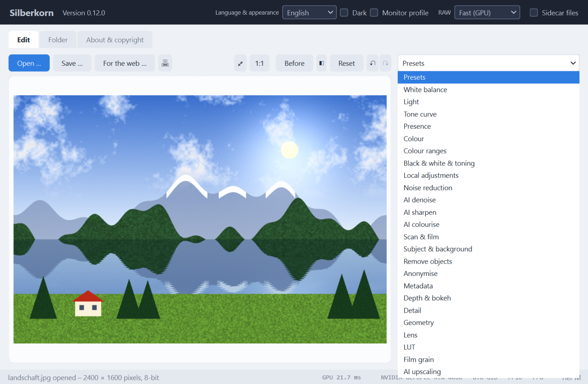
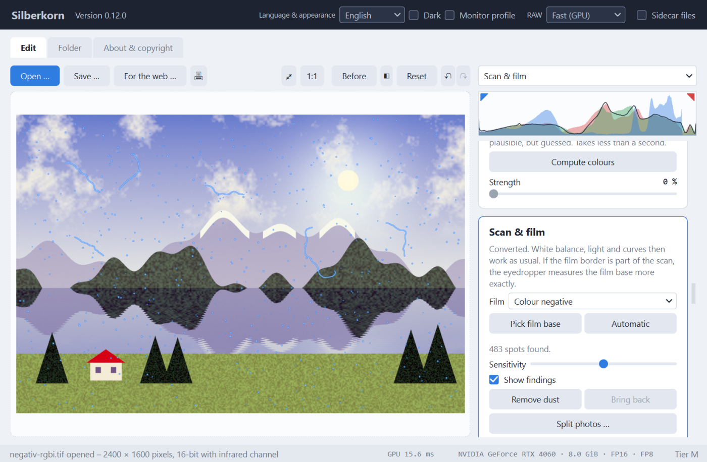
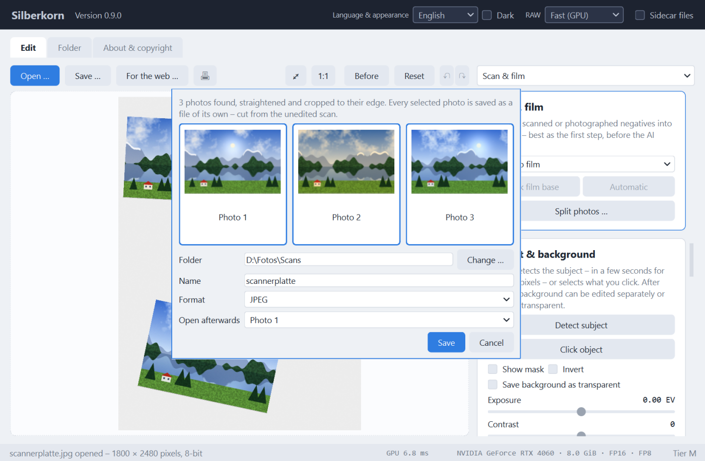
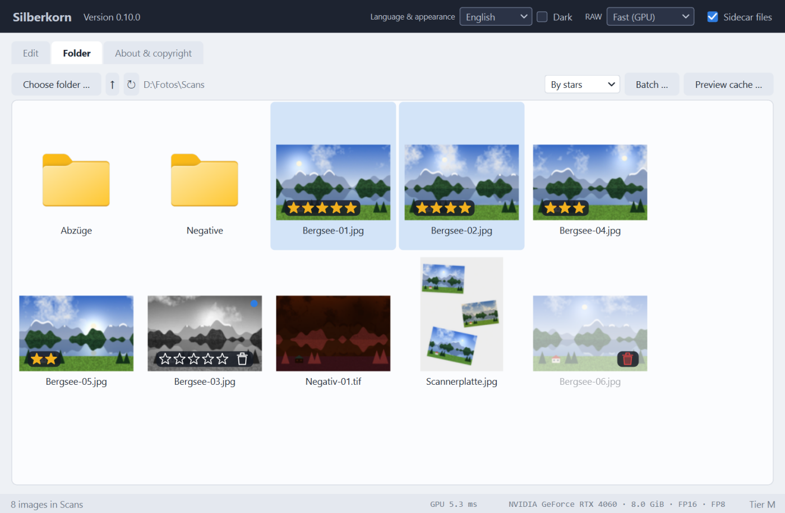

# Features

*Back to the [README](../README.en.md) · Deutsch: [funktionen.md](funktionen.md)*

- **Basic adjustments on the GPU**: white balance (temperature, tint), exposure,
  contrast, highlights, shadows, vibrance, saturation and sharpening with adjustable
  radius.
- **Tone curve** for luminance and for red, green and blue separately, with a histogram
  in the background. Click to add a point, drag to move it, double-click to remove it;
  the luminance curve leaves the colours untouched.
- **Histogram and clipping warning**: a histogram of red, green, blue and luminance sits
  above the cards – always for the whole image, also in the 100 % view. The triangles at
  the top left (shadows) and top right (highlights) switch a warning on: pixels where a
  channel reaches 255 are shown red in the image, those at 0 blue. A triangle fills with
  colour as soon as pixels are really clipped. The marking is display only – it never
  ends up in saved, printed or published images and is missing from "Before" and from the
  left half of the comparison. Key `J` toggles both warnings; they stay as you left them.
- **Automatic adjustments**: "Auto" in the Light card sets exposure, contrast, highlights
  and shadows for a balanced image; "Auto" and "Picker" in the White balance card make the
  image neutral on average or turn the spot you click grey. Everything is measured in the
  crop, each action is one undo step and all other sliders stay as they are. Auto white
  balance and the picker are not available for black and white.
- **Clarity**: more or less local contrast in the midtones.
- **Dehaze** using the dark channel prior – also in reverse, to add haze.
- **Colour ranges (HSL)**: hue, saturation and luminance separately for red, orange,
  yellow, green, aqua, blue, purple and magenta. Computed in the perceptually uniform
  OkLCh colour space with soft transitions between the ranges; greys stay untouched.
- **Black & white & toning**: convert to black and white with a mixer for the same eight
  colour ranges – how bright does each colour turn out as grey? Presets act like classic
  colour filters in front of the lens (red, orange, yellow, green, blue). Plus **split
  toning**: tint highlights and shadows separately, with a balance – toned as in the
  darkroom on black and white (presets sepia, selenium, cyanotype), a colour look on
  colour images. Brightness is kept; white and black stay neutral.
- **Local adjustments**: sliders for one area only – up to ten masks, each made of parts
  that can be added, subtracted, intersected and inverted: gradient, radial and brush;
  with AI the **subject** (BiRefNet), an **object by click** (SAM 2) and a **depth range**
  (Depth Anything); without AI a **luminance range** and a **colour range** (with
  eyedropper). Subject and objects are kept in the sidecar file; with presets and batch
  processing each image computes its own subject and depth. The brush paints with size, feather and opacity and erases with the right
  mouse button or `Alt`; `[` and `]` change the size.
  Per mask temperature, tint, exposure, contrast, highlights, shadows, clarity, haze,
  saturation and sharpness (negative softens). Lines and handles sit right in the image;
  the masks follow rotating, straightening and cropping, and "Show mask" (`O`) tints
  the area.
- **LUTs**: load looks as `.cube` files (3D and 1D), tetrahedral interpolation, with a
  strength slider.
- **Noise reduction**: luminance noise with non-local means, colour noise with a
  colour-guided filter that keeps colour edges – even between colours of equal
  brightness. The scaled-down preview shows less noise than the saved image – use the
  100 % view to judge it.
- **Film grain**: monochrome grain with strength, size and roughness, strongest in the
  midtones while black and white stay clean. Roughness makes it clump as real film does. The size is relative to the image – the
  100 % view shows exactly the grain of the saved image, and with AI upscaling the grain
  is added afterwards instead of being smoothed away by the AI.
- **AI denoise** with SCUNet, trained on real camera noise and for fidelity rather than
  invented detail: computed once over the whole image (an 18 MP photo takes about 20
  seconds on an RTX 4060, 11 with TensorRT); after that a strength slider instantly blends
  between original and denoised image – in the preview, the 100 % view and the export
  alike. Highlights above white, for example from RAWs, are preserved.
- **AI sharpen** for slight focus blur with Restormer, trained on real out-of-focus
  photos from a DSLR and for fidelity: eyelashes, hair and skin texture become clearer
  again, without the halos of classic sharpening. Computed once over the whole image
  (24 MP on an RTX 4060: about three minutes, 45 seconds with TensorRT); after that a
  strength slider responds instantly. If AI denoise has been computed, the denoised image
  is sharpened; only the fine part of the correction is applied, brightness and colour
  stay unchanged.
- **Subject & background** with BiRefNet: the AI detects the subject – people, animals,
  objects – including hair in about two seconds. After that, exposure, contrast,
  saturation, temperature and blur of the background can be set separately, for example
  to darken or soften it; "Invert" applies the sliders to the subject. The edge can be
  softened and shifted, and a mask view tints the background for checking. When saving
  as PNG or TIFF, the background can be made transparent. Needs at least 6 GB of graphics
  memory.
- **Select an object by clicking** with Segment Anything 2 (SAM 2.1), in the same card:
  left-click in the image adds an object or an area, right-click removes one, Ctrl+Z
  undoes the last click. Every click shows the selection within a fraction of a second;
  the sliders, "Invert" and transparent saving work on it like on the detected subject.
  Works from 4 GB of graphics memory.
- **Remove objects** with LaMa: click an object (SAM 2) or paint over it with the brush,
  for example spots or wires – "Remove" fills the spot within a fraction of a second with
  what could be behind it. Several removals build on each other, the last one can be
  undone; the sliders keep working on the whole image. From 4 GB of graphics memory.
- **Depth & bokeh** with Depth Anything V2: the AI estimates in a fraction of a second how
  far away everything in the image is. After that, "Blur" softens the image like a fast
  lens – the more, the further something lies in front of or behind the focal plane. The
  focus is set by a click in the image or a slider, "Depth of field" decides how much
  stays sharp, and a detected subject can be kept fully sharp. The blur is computed in
  linear light so that highlights bloom, and sharp areas do not bleed into blurred ones.
  From 4 GB of graphics memory.
- **AI colourise** with DDColor: black-and-white and sepia images get colour. The AI only
  sees the brightness and estimates the colours from it – plausible, but guessed, not
  historically reliable. The brightness stays that of the original pixel for pixel, even
  for large scans; a slider blends the colour in smoothly, and white balance, saturation
  and colour ranges work as usual afterwards. About 0.1 s, from 4 GB of graphics memory.
- **AI extend** with FLUX.2 [klein] 4B and the outpaint LoRA by fal: instead of cropping
  to an aspect ratio, the AI invents the missing borders to match the image – for
  example to turn a 4:3 photo into 16:9. The original is kept pixel for pixel and set in
  with a soft seam; a colour cast of the AI is measured on the original and removed.
  "Regenerate" rolls new borders; the sliders then work on the whole image. If more than
  a quarter per side is added, the program points out that the AI then invents more
  than it sees. About 15 seconds on an RTX 4060; needs 8 GB of graphics memory.
- **Anonymise**: pixelate, blur or fill faces, number plates or house numbers in black –
  as a rectangle or an ellipse. "Find faces" places an area around every detected face
  (YuNet, included with the program, runs on the processor); areas can be moved,
  resized, removed and drawn by hand. They follow rotation and crop. The mosaic is
  coarse by default, as fine mosaics can be partly reversed. On request Silberkorn saves
  without the GPS position, camera and lens serial numbers, owner name and maker notes.
  The opposite, "unpixelating", is deliberately not offered: an AI could not bring back
  a pixelated face, only invent someone else's.
- **Metadata**: the card shows camera, lens and exposure and lets you change title,
  description, keywords, creator, copyright, location, date taken and rating – for old
  prints the year alone is enough as a date. EXIF, IPTC and XMP are read, from RAW too;
  "All metadata …" shows everything the file contains. Changes are only written when
  saving, as XMP following IPTC and where possible as EXIF as well; "Reset" undoes them.
  On request Silberkorn adds the creator and copyright to every image that has none of
  its own. Technical values such as exposure time or ISO stay unchanged. The orientation
  and the develop settings of other programs (Lightroom, darktable) are dropped from the
  XMP so that they do not take effect a second time there.
- **Save for publishing**: images for the web in one step – downsized to a longest edge
  (quick picks 1280, 1920, 2560 pixels) or a percentage, never enlarged. Plus a visible
  watermark from text and/or a logo, in a corner, in the centre or as a pattern across
  the whole image, with size and opacity. Creator, copyright and web address go into the
  file (EXIF and XMP following IPTC), and on request a machine-readable reservation
  against AI training and data mining (IPTC "Data Mining"; search engines stay allowed).
  GPS position and serial numbers are always removed, the other camera data on request.
  If the image contains parts invented by AI, this is noted (IPTC "Digital Source
  Type"). A preview shows the result; the settings are kept as a template. The original
  stays unchanged. Copying published images cannot be prevented entirely – but the
  watermark and rights information make it unattractive and show where an image came
  from.
- **Print** (🖶 or `Ctrl`+`P`): choose printer and paper, fit the image to the whole page
  or to 9 × 13, 10 × 15, 13 × 18, 20 × 30 cm or a custom size – shown in full or filling
  the area and cropped, with a margin or borderless. A preview shows the sheet, along
  with the resolution on paper. If it is low, the dialog offers to enlarge the image with
  AI first. The edited image is printed at full resolution as sRGB; colour matching is
  left to the printer driver. By default the dialog picks 10 × 15 cm paper if the printer
  knows it.
- **Geometry**: rotate by 90°, flip, straighten, vertical and horizontal perspective, crop
  with a frame and fixed aspect ratios. Empty corners after straightening are cropped
  away automatically. "Auto" sets the straightening from the horizontal and vertical lines
  in the image (up to ±20°); without clear lines the slider stays as it is.
- **Lens**: correct distortion, vignetting and colour fringes (chromatic aberration) – by
  hand or automatically with **lens profiles** from the [lensfun](https://lensfun.github.io)
  database (CC BY-SA 3.0). Camera, lens, focal length and aperture are read from the
  file, adapted lenses included. For RAW a matching profile is applied right away, for
  JPEG only on request (the camera has often corrected it already). Silberkorn downloads
  the database (about 0.5 MB) at the push of a button and checks for a newer one the same
  way – never on its own. All geometry and lens corrections are resampled in a single
  bicubic step.
- **AI upscaling** by 2 × or 4 × when saving, with Real-ESRGAN via ONNX Runtime on the
  GPU: a fast model with a denoise strength slider (from 4 GB of video memory) and a
  large model with more sharpness (from feature tier M). Processing runs in half
  precision (FP16) on the tensor cores and in tiles sized to the video memory; with the
  fast model an RTX 4060 upscales a 24 MP image to 96 MP in just under 6 seconds. The
  optional [TensorRT](../README.en.md#3-tensorrt-optional) makes it about twice as fast again.
- **100 % view**: zoom to 100, 200 and 400 % with the mouse wheel, pan by dragging,
  double-click toggles between fit and 100 %. It shows a part of the image at full
  resolution – exactly what will be saved. The zoom level is shown at the top right of
  the image.
- **Non-destructive**: every change is recomputed from the untouched original.
  Double-click resets a slider, "Before" shows the original while the button is held.
  The ◧ button (key `Y`) puts a movable divider over the image: the original on the
  left, the edited image on the right – with the same rotation and crop. The divider
  stays put in the window while you zoom and pan; double-click the handle to centre it.
- **Card picker**: a drop-down above the cards jumps straight to any card and shows,
  while scrolling, which one is at the top.
- **Undo and redo** with ↶ ↷ or `Ctrl`+`Z` / `Ctrl`+`Y`: for sliders, curves, crop,
  metadata and also AI steps such as denoising, a removed object or an extension – and
  for "Reset". One drag of a slider is one step; the tooltip says what will be undone.
  Superseded AI results take up at most a fifth of the video memory on top; older steps
  are dropped for that.
- **Sidecar file**: when switching images and on exit, Silberkorn saves the edit in a
  small file next to the image (`photo.jpg.silberkorn`) – sliders, curves, LUT, removed
  objects, dust, mask, depth and AI expansion. The next time the image is opened,
  everything is as before. AI denoise, sharpen and colourise are not stored – they would
  take hundreds of MB – and are recomputed on request. The first time, Silberkorn asks
  whether it may create sidecar files; "Sidecar files" at the top changes that. If a
  sidecar file no longer matches the image because the image was changed, Silberkorn
  applies only the slider values after asking. Once everything is reset, it disappears.
- **Folder view** ("Folder" tab): the images of a folder as tiles; a double-click opens
  one for editing. A dot marks images with a sidecar file; their tile shows the edited
  image. Previews are made in the background and only for what is visible – from the
  embedded preview of a RAW, from a JPEG decoded at an eighth of its size or, for large
  TIFFs and PNGs, from the **preview cache**: a file of fixed size you choose (200 MB
  suggested, 0 = off) that is reserved right away. Every preview and path in it is
  encrypted for your own Windows sign-in with the Data Protection API; deleted entries
  are overwritten, and folders can be excluded entirely.
- **Rating** ("Folder" tab): hover over an image and five stars and a wastebasket appear;
  clicking star *n* gives *n* stars, clicking the same star again removes them. The
  wastebasket marks the image as a **reject** (dimmed, always last in any sort order) – it
  **deletes nothing** and does not touch the file. A list sorts by name, date (newest
  first) or stars. The rating is saved in a small XMP file next to the image
  (`photo.jpg.xmp`, rating only) when sidecar files are allowed. **Foreign XMP files of the
  same name** (from darktable, for example) are never touched: their rating is only
  shown. The "Rating" field on the Edit tab and the stars in "Save as" belong to it; a
  reject is not saved there.
- **Batch**: select several images in the folder view (`Ctrl`/`Shift`) and process them
  in one go with "Batch …" – apply a preset or copied settings, remove dust via the
  infrared channel, save the edit as a sidecar file and/or export the images: into a
  folder, as JPEG, PNG, TIFF, WebP or AVIF, with a name suffix, optionally with AI denoise,
  sharpen, colourise and AI upscaling. Existing files are never overwritten. One image
  at a time, cancellable; an error only affects its own image, and a report follows at
  the end.
- **Contact sheet**: the 🖶 button in the folder view lays the selected images – otherwise
  all in the folder – onto paper as a grid, in the order of the view: 2 to 8 columns,
  each image in full, with file name and stars below, folder and page number at the top.
  Portrait or landscape, to a printer or as a PDF file; rejects can be left out. The
  images carry their edit from the sidecar file (without AI results), at 300 dpi for
  their cell. The preview shows the pages with the thumbnails; cancelling outputs
  nothing.
- **Presets**: save settings under a name and apply them to other images – choosing
  what to include: basic adjustments, curves, colour ranges, black & white & toning,
  LUT, noise reduction, film grain and film are preselected; geometry, anonymisation and metadata usually belong to one image
  only. For film, optionally with the measured film base for images from the same strip;
  otherwise it is estimated anew for each image. `Ctrl`+`Shift`+`C` / `V` copy settings
  straight from one image to the next. Presets are stored as JSON in the `voreinstellungen`
  folder next to the program and can be imported and exported.
- **Fast**: the preview is computed at screen resolution in a few milliseconds; the
  computing time is shown in the status bar. Saving uses the full resolution.
- **Colour-accurate**: processing happens in linear light with 32-bit floating point.
  RGB colour profiles such as Adobe RGB, ProPhoto RGB or Display P3 are converted to sRGB
  on the GPU without a detour through 8 bits; colours outside sRGB are kept until the
  output. The EXIF orientation is applied; metadata (EXIF, IPTC, XMP) and an alpha
  channel are kept when saving in every format – the camera data of a RAW included.
  With “Monitor profile” at the top, the display is converted to the colour profile of
  the screen the window is on – for wide-gamut screens; saving, printing and the
  histogram stay sRGB.
- **16 bits and RAW**: opens and saves TIFF and PNG with 16 bits per channel. RAW files
  from practically every camera (CR2, CR3, NEF, ARW, RAF, ORF, RW2, DNG and more) are
  developed in linear light without automatic brightening – the full range of the sensor
  is kept, and exposure controls the brightness. For Bayer sensors, i.e. almost every
  camera, demosaicing runs on the GPU – after Malvar, He and Cutler. A 24-megapixel RAW
  opens in about 0.2 s instead of over a second. Fujifilm X-Trans sensors are developed
  on the GPU as well, with a dedicated edge-aware method for the 6×6 pattern – hardly
  distinguishable from LibRaw, but in milliseconds instead of seconds. For even fewer
  colour fringes in fine patterns, choose "RAW: Best quality" at the top – then LibRaw
  develops on the processor, with DHT or, for X-Trans, Markesteijn (about 1.5 to 3 s).
  Other sensors (Foveon …) are always developed by LibRaw.
- **Scan & film**: scanned negatives or negatives photographed with a camera – colour or
  black-and-white – are converted into positives via the density of the film, as in the
  lab. Silberkorn estimates the orange film base as well as black and white point per
  colour channel by itself and so removes the colour cast; the unexposed film border can
  also be picked with the eyedropper. After that, all sliders and AI cards work on the
  positive. TIFF scans with an infrared channel (RGBI, for example from VueScan or
  SilverFast) are recognised as such instead of showing up half transparent. Through
  this channel the card finds dust, fibres and scratches – film lets infrared through,
  dust does not – and fills them: small specks on the GPU, wide spots with LaMa. At
  24 megapixels this takes less than a second; "Before" and undo work as usual. An
  infrared channel that shows the scene itself (aerial images, black-and-white film with
  silver, Kodachrome) is recognised and not taken for dust.
  "Split photos …" finds several prints on a flatbed scan, crooked ones included,
  straightens each one, crops it to its edge and saves it as a file of its own (Name-01,
  Name-02 …, without overwriting anything); Silberkorn then opens one of them for editing.
- **Formats**: opens JPEG, PNG, TIFF, WebP, AVIF, BMP and RAW (HEIC with the optional
  `pillow-heif` package); saves JPEG, WebP and AVIF with 8 bits, PNG and TIFF with 8 or
  16 bits. At the same quality AVIF is about half the size of JPEG; images with more than
  8 bits are read as 8 bits.
  For images with more than 8 bits the save dialog suggests a 16-bit TIFF.

| Card picker | Scan & film |
|---|---|
|  |  |
| **Split photos** | **Folder view** |
|  |  |

*The motifs are computed, not photographs – made with `werkzeuge/bildschirmfotos.py`.*

| Key | Action |
|---|---|
| `Ctrl`+`O` | open an image (or drag a file onto the canvas) |
| `Ctrl`+`S` | save … – always under a new name, the original is never overwritten silently |
| `Ctrl`+`P` | print … |
| `Ctrl`+`Z` / `Ctrl`+`Y` | undo / redo (also `Ctrl`+`Shift`+`Z`); while selecting by click, `Ctrl`+`Z` first undoes the clicks |
| `Ctrl`+`Shift`+`C` / `V` | copy settings / paste them onto another image |
| `Ctrl`+`0` / `Ctrl`+`1` | fit / 100 % |
| `Y` | turn the before/after comparison with a movable divider on / off |
| `J` | turn the warning for clipped shadows and highlights (blue / red) on / off |
| mouse wheel, drag, double-click | zoom, pan, toggle between fit and 100 % |
| `Enter` / `Esc` | apply / cancel crop |
